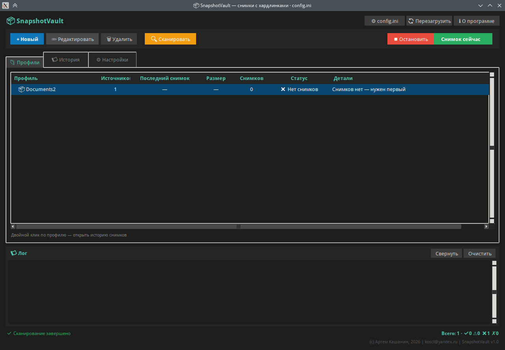

# SnapshotVault v1.0 — Резервное копирование с хардлинками

> **© AKSoft, 2026** | koscl@yandex.ru

SnapshotVault создает резервные копии папок в виде «снимков». Каждый снимок выглядит как обычная папка, в которой лежат **все** файлы проекта. Но файлы, которые не менялись с прошлого раза, занимают место только один раз (благодаря технологии хардлинков). Это позволяет хранить десятки версий проекта, не забивая жесткий диск.



---

## 1. Состав пакета и первый запуск

В пакете два исполняемых файла:

- **SnapshotVault.exe** — графическая версия (GUI). Для обычной работы.
- **snapshotvault-cli.exe** — консольная версия (CLI). Для автоматизации, планировщика задач и скриптов.

### Первый запуск

При первом запуске **любая** из версий автоматически создаст файл `config.ini` рядом с собой, с настройками по умолчанию (один профиль «Documents» для папки `~/Documents`). Откройте его и отредактируйте профили под свои нужды.

- **В GUI:** нажмите кнопку «⚙ config.ini» в верхней панели — файл откроется в Блокноте. После редактирования нажмите «🔄 Перезагрузить» в программе.
- **В CLI:** просто отредактируйте `config.ini` в любом текстовом редакторе и запустите команду снова.

### Linux

Файлы называются `SnapshotVault` (GUI) и `snapshotvault-cli` (CLI). Не забудьте про права на исполнение:

```bash
chmod +x SnapshotVault snapshotvault-cli
```

Если GUI не открывается — установите `tkinter`:

| Дистрибутив | Команда |
| --- | --- |
| Debian/Ubuntu | `sudo apt install python3-tk` |
| Fedora | `sudo dnf install python3-tkinter` |
| Arch | `sudo pacman -S tk` |

CLI-версия работает без tkinter.

---

## 2. Где хранятся снимки

По умолчанию снимки сохраняются в папку `SnapshotVault` в вашем домашнем каталоге:

- **Windows:** `C:\Users\ВашеИмя\SnapshotVault`
- **Linux:** `/home/имя/SnapshotVault`

Структура папок:

```
SnapshotVault/
  Документы/                  <-- Имя профиля
    manifest.json             <-- Служебный файл (список всех снимков)
    backup.log                <-- Лог профиля
    snapshots/
      2026-11-20_14-30-00/    <-- Снимок (обычная папка с файлами)
        files.json            <-- Список файлов и их хэши
        ...файлы и папки...
```

> **Внимание:** Файлы внутри снимков защищены от записи (Read-Only). Это нужно, чтобы случайно не испортить историю (так как один и тот же файл физически лежит сразу в нескольких снимках).

---

## 3. Главное окно GUI (вкладка «Профили»)

Программа умеет работать с несколькими независимыми папками (Профилями). Например: профиль «Документы» для папки Мои документы, и профиль «Проекты» для папки с кодом.

Кнопки на верхней панели:

- **+ Новый** — создать новый профиль.
- **✏ Редактировать** — изменить настройки существующего профиля.
- **🗑 Удалить** — удалить профиль из конфига (снимки на диске **не** стираются).
- **🔍 Сканировать** — проверить, есть ли изменения в файлах с момента последнего снимка.
- **📸 Снимок сейчас** — принудительно создать резервную копию прямо сейчас.
- **⏹ Остановить** — прервать текущий процесс сканирования или создания снимка.

Дополнительно: по правому клику (ПКМ) на профиле открывается контекстное меню с теми же действиями плюс пункт «ℹ Свойства» (показывает пути и настройки).

Двойной клик по профилю — открыть вкладку «История» с его снимками.

---

## 4. Как читать статусы профиля

- ✅ **Свежий** — все файлы в папке-источнике совпадают с последним снимком.
- ⚠ **Устарел** — есть новые, измененные или удаленные файлы. Пора делать снимок.
- ❌ **Нет снимков** — история пуста, нужно создать первый снимок.
- ✗ **Ошибка** — профиль битый: нет доступных источников (папки не найдены) или повреждён манифест. Профиль всё равно отображается в списке — нажмите ПКМ → «Редактировать» или «Удалить».
- ☁ **Offline** — локальных снимков нет, но копии есть на флешке/внешнем ЖД. Данные не потеряны: подключите носитель и скопируйте снимки обратно (или нажмите «📸 Снимок сейчас» — создастся новый полный снимок).

**Почему так:** в `manifest.json` есть запись о том, что снимки синхронизировались на носитель, а локально папок снимков нет. Программа **не** проверяет, что файлы на носителе реально существуют (если флешку отформатировали — статус останется «Offline»). Просто создайте новый снимок — статус сменится на «Свежий».

---

## 5. Работа с историей (вкладка «История»)

Выберите профиль в выпадающем списке сверху, чтобы увидеть список его снимков.

- 🔄 **Обновить** — обновить список снимков.
- 📂 **Открыть снимок** — открыть папку снимка в Проводнике. Вы можете скопировать оттуда нужные файлы вручную, они доступны только для чтения.
- ↩ **Восстановить** — скопировать все файлы из выбранного снимка в указанную вами папку. Восстановление в папку-источник или в папку бэкапа запрещено (во избежание потери данных).
- 🔀 **Diff** — сравнить два снимка и увидеть, какие файлы добавились, удалились или изменились.
- 🕘 **История файла** — введите относительный путь файла (например, `src/main.py`) и увидите, в каких снимках он присутствовал и как менялся его размер.
- 💾 **Флешки** — поиск внешних носителей, создание метки и синхронизация.
- 📊 **Занято** — покажет логический размер всех снимков и **реальный** размер на диске (с учетом экономии от хардлинков).

### Что такое `no_change`?

Если при проверке программа не нашла изменений, она не создаёт новую папку, а делает запись в манифесте с пометкой `no_change`. В истории такие записи видны серым цветом, у них 0 файлов и 0 байт. Это нормально — так вы видите, что проверка в это время проходила, а изменений не было.

---

## 6. Флешки и внешние диски

Программа может дублировать снимки на флешку или внешний HDD. Для этого в корне носителя должен лежать файл-метка:

- **Имя файла:** `SV_BACKUP_ALLOW.txt`
- **Содержимое:** `SnapshotVault backup marker`

В окне «💾 Флешки» нажмите «Создать метку» и выберите корень вашей флешки.

### Автосинхронизация

Если в профиле включена галка «Синхронизация с носителями», то при каждом создании **реального** снимка (с изменениями) программа автоматически:

1. Ищет все носители с меткой (кроме системного диска, папки бэкапа и папок-источников).
2. Копирует свежий снимок на каждый найденный носитель (если его там ещё нет).
3. Применяет ротацию на носителе (см. «Ротация на носителях»).

Снимки `no_change` **не** синхронизируются — в них нет файлов, копировать нечего.

### Важно про файловую систему

На флешку файлы копируются обычным способом (без хардлинков), так как файловая система FAT32/exFAT их не поддерживает. Снимок на флешке — самодостаточный, но занимает полный размер.

### Linux

Флешки монтируются в `/media/$USER/<label>` или `/run/media/$USER/<label>`. Метка должна быть в корне смонтированного раздела.

---

## 7. Командная строка (CLI)

Для автоматизации (Планировщик задач Windows, `cron`/`systemd` на Linux) используйте `snapshotvault-cli` (на Linux — `snapshotvault-cli` без `.exe`).

```
snapshotvault-cli --action snapshot
```
Создать снимок для всех профилей и выйти.

```
snapshotvault-cli --action snapshot --profile "Documents"
```
Создать снимок только для профиля `Documents`.

```
snapshotvault-cli --action snapshot --full
```
Принудительно создать полный снимок (скопировать все файлы, игнорируя хардлинки).

```
snapshotvault-cli --action snapshot --watch
```
Режим демона: программа будет работать в фоне и делать снимки согласно интервалу, указанному в конфиге для каждого профиля. Остановка — `Ctrl+C`.

```
snapshotvault-cli --action list
```
Показать список профилей и их статус.

```
snapshotvault-cli --action integrity
```
Проверить целостность снимков (наличие файлов, совпадение размеров).

```
snapshotvault-cli --action integrity --full
```
Проверить целостность с подсчетом SHA-256 хэшей (долго, но надежно).

```
snapshotvault-cli --action rebuild
```
Пересобрать `manifest.json` из папок снимков (если манифест повреждён).

### Пример для cron (Linux)

Создавать снимок каждый час:

```bash
crontab -e
# добавить строку:
0 * * * * cd /path/to/SnapshotVault && ./snapshotvault-cli --action snapshot >> /tmp/snapshotvault.log 2>&1
```

### Пример для Планировщика задач (Windows)

- **Действие:** «Запуск программы»
- **Программа:** путь к `snapshotvault-cli.exe`
- **Аргументы:** `--action snapshot`
- **Рабочая папка:** папка с программой

---

## 8. Важно о хардлинках (ЧАВО)

**В: Почему снимки занимают так мало места?**
**О:** Неизмененные файлы создаются не как копии, а как «хардлинки» на файл из предыдущего снимка. Файловая система считает, что это один и тот же файл, поэтому место на диске расходуется только один раз.

**В: А если я удалю старый снимок, пропадут ли файлы из нового?**
**О:** Нет. Хардлинк — это просто второе имя для файла. Пока существует хотя бы одно имя (снимок), сам файл на диске остается. Данные не пропадут.

**В: Почему файлы в снимках нельзя редактировать?**
**О:** Потому что файл физически один. Если вы откроете его в снимке за 1 ноября и измените, то он изменится и в снимке за 20 ноября. Чтобы этого не случилось, программа ставит на файлы атрибут «Только чтение».

**В: Работают ли хардлинки на флешках?**
**О:** Нет. Флешки обычно отформатированы в FAT32 или exFAT, которые не поддерживают хардлинки. Программа определит это и будет копировать файлы.

**В: Работают ли хардлинки между разными дисками?**
**О:** Нет. Хардлинк может указывать на файл только в пределах одного раздела (тома). Если папка-источник на диске `C:`, а бэкап на диске `D:`, хардлинки не сработают, и снимки будут занимать полный размер. Программа предупредит об этом в логе при запуске.

**В: Программа пишет «Хардлинки недоступны, копирую...» — это ошибка?**
**О:** Нет, это нормально. Скорее всего, источник и бэкап на разных томах, либо файловая система не поддерживает хардлинки. Программа автоматически переключается на обычное копирование. Снимки будут занимать больше места, но данные сохранятся.

---

## 9. Файл конфигурации (config.ini)

Все настройки хранятся в файле `config.ini` рядом с программой. Вы можете редактировать его вручную (закройте программу или нажмите «🔄 Перезагрузить» в GUI после редактирования).

```ini
[General]
backup_base = ~/SnapshotVault   ; Куда сохранять бэкапы
logging_enabled = true          ; Вести лог-файлы
external_enabled = true         ; Глобально разрешить синхронизацию с носителями

[Exclude]
patterns =                      ; Глобальные исключения (по маске)
    *.tmp
    .git

[Profile:Documents]             ; Настройки конкретного профиля
paths =
    ~/Documents
rotation_n = 10                 ; Хранить последние 10 снимков (0 = все)
interval_min = 30               ; Интервал проверки в минутах
external_enabled = true         ; Автосинхронизация для этого профиля
external_rotation_n = 5         ; Хранить последние 5 снимков на носителе
```

---

## 10. Частые проблемы

### Профиль не отображается в списке

Профили с несуществующими папками-источниками **не** пропадают. Они отображаются со статусом «✗ Ошибка». Нажмите ПКМ → «Редактировать», укажите существующую папку и сохраните. Или ПКМ → «Удалить».

### Флешка не появляется в списке носителей

Проверьте:

1. Метка `SV_BACKUP_ALLOW.txt` лежит **в корне** флешки (не в подпапке).
2. Содержимое метки содержит строку `SnapshotVault backup marker`.
3. В настройках профиля включено «Искать на всех томах», если ваш носитель определяется системой как внешний ЖД (а не съёмный).
4. На Linux: флешка смонтирована в `/media/$USER/` или `/run/media/$USER/`.

### При снимке в логе «Изменений нет — no_change», а я ожидал копию на флешку

Автосинхронизация запускается только при создании реального снимка. Если изменений нет — нет и копии. Сделайте изменение в файлах или воспользуйтесь кнопкой «📤 Синхронизировать» в окне «💾 Флешки» вручную (она скопирует последний реальный снимок, даже если он старый).

### Кнопка «Снимок сейчас» ничего не делает

Проверьте, что папка-источник существует и доступна на чтение. Если вы запустили CLI-версию из консоли — там будут сообщения об ошибке.

### «Восстановление в папку источника запрещено»

Это защита. Нельзя восстанавливать снимок поверх папки, с которой он снят (иначе данные источника будут перезаписаны). Выберите другую папку, например `SnapshotVaultRestore/2026-11-20_14-30-00/` в вашем домашнем каталоге.

### Программа не запускается на Linux

Установите tkinter: `sudo apt install python3-tk` (или аналог для вашего дистрибутива). CLI-версия работает без tkinter.

### «Не удалось расшифровать пароль» / «Конфиг битый»

Если `config.ini` повреждён, программа сообщит об ошибке и **не** пересоздаст файл автоматически (чтобы не потерять ваши профили). Исправьте конфиг вручную или удалите его — при следующем запуске будет создан дефолтный.

---

## Лицензия и отказ от ответственности

Программа распространяется бесплатно «как есть» (as is). Автор не несет ответственности за потерю данных. **Всегда** делайте резервные копии важных файлов на независимых носителях.

---

- **GitHub:** https://github.com/artemsoft2025/
- **Telegram:** https://t.me/avhelpnew
- **Email:** koscl@yandex.ru
